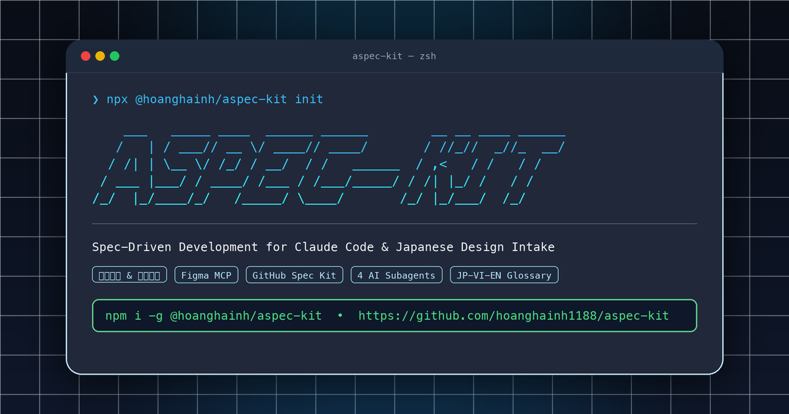

# aspec-kit — Spec-Driven Development Framework with Claude Code & Japanese Design Intake

<p align="center">
  
</p>

[](https://www.npmjs.com/package/@hoanghainh/aspec-kit)
[](https://github.com/hoanghainh1188/aspec-kit/actions)
[](https://opensource.org/licenses/MIT)
[](https://github.com/github/spec-kit)

> **Inspired by GitHub's Spec-Driven Development initiative**, `aspec-kit` is reimagined as an ultra-lightweight, zero-dependency toolkit tailored for **Claude Code** and AI-first engineering teams.

Production-ready greenfield project template and toolkit for **Claude Code**, specifically engineered for **Bridge Software Engineers (BrSE)** and development teams working with Japanese clients where upstream design artifacts come from **Basic Design (基本設計)**, **Detail Design (詳細設計)**, and **Figma**.

---

## Key Highlights

- **[GitHub Spec Kit](https://github.com/github/spec-kit) Backbone**: End-to-end specification-driven pipeline (`constitution` -> `specify` -> `clarify` -> `plan` -> `tasks` -> `analyze` -> `implement`).
- **5 Specialized Claude Code Subagents**: Fills the gap that raw Spec Kit does not cover:
  - `design-intake`: Parses Japanese specifications and Figma (via MCP) into structured intake artifacts.
  - `code-reviewer`: Cross-references implementation against 4 truth sources (constitution, spec, plan, tasks).
  - `glossary-steward`: Guards terminology fidelity across Japanese, Vietnamese, and English in code and specs.
  - `security-reviewer`: Specialized OWASP Top 10, secret detection, and PII audit pass.
  - `impact-analyzer`: Diffs two client design versions (仕様変更) and traces each change to the intake, spec ACs, tasks, source files, and tests it affects — driven by `/design-change`.
- **BrSE Toolkit for Japanese Client Projects**: The daily chores around the client, built in:
  - `/qa-sheet`: Turns intake ambiguities into a business-polite (敬語) 質問票 (`.md` + Excel-ready CSV) and records the client's answers in `docs/04-decisions/`.
  - `/design-change`: 仕様変更 impact report: what to change and why, which `/speckit-*` steps to re-run, and a Japanese 影響範囲 summary for the client.
  - `aspec-kit convert`: Converts 詳細設計 Excel/PDF into Markdown that agents can read, without touching the original.
- **Maintainable Scaffold**: `aspec-kit update` pulls template fixes into existing projects with a 3-way merge, and `aspec-kit doctor` checks tools and guardrails (see [CLI Commands](#cli-commands)).
- **5-Tier Git-Backed Project Memory**: Externalizes knowledge in Git files to eliminate AI context drift without database infrastructure overhead.
- **Zero-Conflict Team Workflow**: Combines GitHub Issue IDs for branch naming (`NNN-<slug>`) and timestamp-based specification paths to prevent collision during parallel feature development.

---

## 3 Ways to Use aspec-kit

### Method 1: Instant Start via npm CLI (Recommended — Fastest, Zero-Config)

```bash
# Initialize into a new directory
npx @hoanghainh/aspec-kit init my-project
# or initialize directly into current directory
npx @hoanghainh/aspec-kit init .
# or standard npm init / create
npm init @hoanghainh/aspec-kit my-project
```

The CLI automatically fetches the latest template, interactively configures `.github/CODEOWNERS` with your Steward handle, and optionally cleans up the reference sample feature.

Options: `-y/--yes`, `--steward <handle>`, `--stack ts|python|go|java`, `--lang vi|en|ja`, `--agent claude|gemini|copilot|cursor`, `--clean`, `--force`, `--template-ref <ref>`, `--help` (see [`packages/aspec-kit/README.md`](packages/aspec-kit/README.md)). Existing files are never overwritten unless `--force` is passed, and the template is pinned to the tag matching the CLI version.

After scaffolding:
```bash
cd my-project
bash bootstrap.sh
```

Later, pull template fixes (agents, runbooks, hooks, CI) into the project without touching your
design docs, glossary, decisions, specs or `src/`:
```bash
npx @hoanghainh/aspec-kit update --dry-run   # preview; drop --dry-run to apply
```
Files you edited are kept; if the template changed them too, the new version is written next to them
as `<file>.aspec-new` for a manual merge (details: [`packages/aspec-kit/README.md`](packages/aspec-kit/README.md#updating-a-project)).
All CLI commands are listed in [CLI Commands](#cli-commands).

### Method 2: Use as GitHub Template Repository

1. Fork/clone this repository to your GitHub account.
2. In repository Settings, check **"Template repository"**.
3. For each new project, click **"Use this template"** -> **"Create a new repository"**.
4. Clone your new repo locally, and run `bash bootstrap.sh` to install Spec Kit CLI and generate `.claude/skills/`.
5. Launch Claude Code and run `/speckit-constitution`. Then consult [`docs/CONSTITUTION_APPEND.md`](docs/CONSTITUTION_APPEND.md) to add articles tailored for Japanese client contexts.

### Method 3: Install as Claude Code Plugin (For Existing Projects)

Ideal when you want to equip existing codebases with aspec-kit agents and slash commands:

```bash
# Inside Claude Code
/plugin marketplace add hoanghainh1188/aspec-kit
/plugin install aspec-kit@hoanghainh1188
```

Installs the 5 subagents (`design-intake`, `code-reviewer`, `security-reviewer`, `glossary-steward`, `impact-analyzer`) and the `/design-to-code`, `/design-change` and `/qa-sheet` commands into user scope (`~/.claude/`). See details in [`plugin/README.md`](plugin/README.md).

---

## CLI Commands

The npm CLI has no dependencies and covers the whole lifecycle of a project. Full options are in [`packages/aspec-kit/README.md`](packages/aspec-kit/README.md).

| Command | What it does |
|---|---|
| `npx @hoanghainh/aspec-kit init <dir>` | Scaffold a new project. Existing files are never overwritten without `--force`. |
| `npx @hoanghainh/aspec-kit update [--dry-run] [--to <ref>]` | Pull template fixes into an existing project with a 3-way merge. Client docs, glossary, decisions, specs and `src/` are never touched. |
| `npx @hoanghainh/aspec-kit doctor [--json]` | Check tools, Spec Kit skills, CODEOWNERS, formatter and branch protection. Prints a fix hint for each problem. |
| `npx @hoanghainh/aspec-kit convert <file.xlsx\|pdf>` | Convert a 詳細設計 workbook or PDF into Markdown next to the original. Requires [uv](https://docs.astral.sh/uv/). |

---

## Directory Structure

```text
<project>/
├── CLAUDE.md                       Core conventions read by AI agents first
├── bootstrap.sh                    Runs specify init and integrates skills & hooks
├── .claude/
│   ├── settings.json              Configured permission rules (deny -> ask -> allow)
│   ├── agents/
│   │   ├── design-intake.md       Extracts JP docs & Figma -> generates intake for /speckit-specify
│   │   ├── code-reviewer.md       Post-implementation verification against 4 sources
│   │   ├── security-reviewer.md   OWASP, secret detection, and PII audit
│   │   ├── glossary-steward.md    Guards JP-VI-EN terminology consistency
│   │   └── impact-analyzer.md     仕様変更 diff -> impacted artifacts with reasons (read-only)
│   ├── hooks/
│   │   └── format.sh              Format-on-save hook triggered on file edit
│   ├── commands/
│   │   ├── design-to-code.md      Hybrid orchestration runbook command
│   │   ├── design-change.md       /design-change <old> <new>: 仕様変更 impact report
│   │   └── qa-sheet.md            質問票: intake ambiguities -> client Q&A sheet, answers -> decisions
│   └── scripts/
│       ├── qa_sheet.py            Deterministic part of /qa-sheet (validate, CSV with UTF-8 BOM, ingest)
│       └── convert-design.py      詳細設計 .xlsx/.pdf -> Markdown (run via uv; used by `aspec-kit convert`)
├── docs/
│   ├── 00-glossary.md              Single source of truth for JP / VI / EN business terms
│   ├── 01-basic-design/            基本設計 directly from client (read-only)
│   ├── 02-detail-design/           詳細設計 directly from client (read-only)
│   ├── 03-ui/                      Figma link registry & design snapshots
│   ├── 04-decisions/               Decisions from /speckit-clarify (INDEX.md = lookup table)
│   ├── 05-lessons.md               Technical gotchas and project lessons learned
│   ├── intake/                     Output artifacts from design-intake
│   ├── changes/                    仕様変更 impact reports from /design-change
│   ├── qa/                         質問票 (Q&A sheets) for the client: <NNN>-<slug>.md + .csv
│   └── CONSTITUTION_APPEND.md      Recommended constitution articles for JP projects
├── src/                            Application source code (src/features/<slug>/)
├── tests/                          Automated test suites
├── packages/
│   └── aspec-kit/                  Official CLI generator package (@hoanghainh/aspec-kit)
├── .claude-plugin/                 Plugin and marketplace catalog metadata
└── plugin/
    └── README.md                   Plugin usage guide
```

After running `bootstrap.sh`:
```text
├── .specify/
│   ├── memory/constitution.md      Generated by /speckit-constitution
│   ├── templates/                  Spec Kit templates
│   └── scripts/                    Spec Kit helper scripts
├── .claude/skills/speckit-*/       Spec Kit skills (specify, clarify, plan, tasks, analyze, implement...)
└── specs/                          Feature specifications directory
```

---

## Reference Sample Feature (Removable)

The template includes a miniature reference feature — **予約承認 (Reservation Approval)** — to demonstrate end-to-end traceability and code layout:
- `docs/intake/000-example-reservation.md`: Sample output from `design-intake`.
- `docs/04-decisions/2026-01-01-approval-vs-confirm.md`: Sample decision artifact.
- `docs/qa/000-example-reservation.md` + `.csv`: Sample 質問票 generated by `/qa-sheet` from the intake ambiguities.
- `specs/000-example-reservation/`: Sample `spec.md`, `plan.md`, and `tasks.md`.
- `src/features/example-reservation/`: Sample TypeScript implementation and unit tests illustrating TDD under Article W.
- `docs/02-detail-design/example-reservation/`: Sample client detail design, `field-spec-v1.md` → `field-spec-v2.md` + `CHANGELOG.md` (a 仕様変更 fixture).
- `docs/changes/2026-10-31-example-reservation.md`: Sample `/design-change` impact report for that v1 → v2 change.

**To clean up the sample feature before starting a real project:**
```bash
rm -rf specs/000-example-reservation \
       src/features/example-reservation \
       docs/intake/000-example-reservation.md \
       docs/04-decisions/2026-01-01-approval-vs-confirm.md \
       docs/02-detail-design/example-reservation \
       docs/changes/2026-10-31-example-reservation.md \
       docs/qa/000-example-reservation.md \
       docs/qa/000-example-reservation.csv
# Remove the sample entry from INDEX.md:
python3 -c "
from pathlib import Path
p = Path('docs/04-decisions/INDEX.md')
lines = [l for l in p.read_text().splitlines() if '000-example-reservation' not in l]
p.write_text('\n'.join(lines) + '\n')
"
```
*(Note: If you use `npx @hoanghainh/aspec-kit --clean`, this clean-up is done automatically).*

---

## Feature Workflow

### Human Interaction Steps
1. **Create a GitHub Issue** for the feature (Issue # = Feature ID), then branch out as `NNN-<slug>` where `NNN` is zero-padded to at least 3 digits (e.g., Issue #42 -> `042-user-reservation`).
2. **Place upstream specifications** in dedicated folders:
   - `docs/01-basic-design/<slug>/` — 基本設計 (user stories & high-level behavior).
   - `docs/02-detail-design/<slug>/` — 詳細設計 (field tables, validation rules, business edges, errors).
   - `docs/03-ui/<slug>/figma-links.md` — Figma nodes and reference screenshots.
   *(Note: Claude's `Read` cannot parse binary Office/PDF files. For `.xlsx`/`.pdf`, run
   `npx @hoanghainh/aspec-kit convert <file>` to write Markdown next to the untouched original
   (see [`docs/02-detail-design/README.md`](docs/02-detail-design/README.md)). For `.docx`, export a
   text/markdown copy alongside the original.)*
3. **Execute `/design-to-code`** in Claude Code, providing document paths when prompted.
4. Claude runs each Spec Kit step (`speckit-specify|clarify|plan|tasks|analyze|implement`) itself via the **Skill tool** and pauses for you to review the artifact. Answer `clarify` questions in chat. Only if a skill is missing or blocked does it fall back to **[HANDOFF]**: copy and run the `/speckit-*` command it prints. See [`docs/04-decisions/2026-10-31-runbook-auto-invoke-speckit.md`](docs/04-decisions/2026-10-31-runbook-auto-invoke-speckit.md).
5. Review checkpoints at every **[PAUSE]** (intake review, analyze gate, test gate, deployment).
6. **Ambiguities that only the client can answer** → run `/qa-sheet <NNN>-<slug>` to turn the intake's
   *Ambiguities* into a business-polite (敬語) 質問票 `docs/qa/<NNN>-<slug>.md` + Excel-ready CSV
   (UTF-8 BOM), each question with a stable ID `Q-<NNN>-<ii>`. When the client answers, run
   `/qa-sheet --ingest docs/qa/<NNN>-<slug>.csv` to record the answers in `docs/04-decisions/` + `INDEX.md`
   (already-recorded questions are skipped), then re-run `/speckit-clarify`. See [`docs/qa/README.md`](docs/qa/README.md).
7. **When the client sends a new design version (仕様変更)**: add it as a new file + `CHANGELOG.md` entry, run `/design-change <old> <new>`, review the report in `docs/changes/` (impact table with reasons, suggested `/speckit-*` re-runs, Japanese 影響範囲 summary for the client), then re-run the pipeline as suggested. See [`docs/changes/README.md`](docs/changes/README.md).

### Workflow Diagram

```mermaid
flowchart TD
    A["📁 Place design docs in docs/01-03/"]:::user --> B["⌨️ Run /design-to-code"]:::user
    B --> B2["Recall memory: constitution + glossary<br/>+ decisions INDEX + lessons"]:::auto
    B2 --> C["Create git branch NNN-feature"]:::auto
    C --> D["design-intake reads docs → docs/intake/"]:::auto
    D --> E{"PAUSE — Review intake<br/>prompt & ambiguities"}:::stop
    E --> F["speckit-specify (Skill) — prompt from intake<br/>PAUSE review spec"]:::skill
    F --> G{"Ambiguities detected?"}:::stop
    G -- Yes --> H["speckit-clarify (Skill, you answer)<br/>→ docs/04-decisions/"]:::skill
    G -- No --> I["speckit-plan (Skill)<br/>PAUSE review plan"]:::skill
    H --> I
    I --> J["speckit-tasks (Skill)<br/>PAUSE review tasks"]:::skill
    J --> K{"PAUSE — speckit-analyze (Skill)<br/>any warnings?"}:::stop
    K -- Yes, fix spec/plan/tasks --> F
    K -- No --> L["speckit-implement (Skill, after your OK)<br/>→ generate code"]:::skill
    L --> M{"code-reviewer<br/>any Blocking issues?"}:::auto
    M -- Yes --> L
    M -- No --> Q["glossary-steward<br/>verify terms vs glossary"]:::auto
    Q --> R{"security-reviewer<br/>(if auth/data touched)<br/>any Blocking issues?"}:::auto
    R -- Yes --> L
    R -- No --> N{"PAUSE — test gate<br/>lint/test/build green<br/>+ coverage ≥ threshold?"}:::stop
    N -- Red --> L
    N -- Green --> O["PAUSE — deploy per CLAUDE.md"]:::stop
    O --> P["✅ Commit intake + decisions + specs"]:::user

    classDef user fill:#e0f2fe,stroke:#0369a1,color:#0c4a6e
    classDef auto fill:#dcfce7,stroke:#15803d,color:#14532d
    classDef skill fill:#fef9c3,stroke:#a16207,color:#713f12
    classDef stop fill:#fee2e2,stroke:#b91c1c,color:#7f1d1d
```



**Step Categories:**
- 🟦 **User Action**: Manual inputs and reviews.
- 🟩 **[AUTO]**: Claude executes automatically (git branch, calling subagents).
- 🟨 **[SKILL]**: Claude invokes the Spec Kit skill itself via the Skill tool, then pauses for your review. Fallback **[HANDOFF]** (skill missing/blocked): you paste and run the `/speckit-*` command Claude prints.
- 🟥 **[PAUSE]**: Mandatory approval gate.

---

## Team Workflow & Conflict Prevention

When multiple team members collaborate on a single repository:

- **Feature ID = GitHub Issue Number**: Branch as `NNN-<slug>` (e.g., `#42` -> `042-user-reservation`). Global uniqueness guarantees zero branch collisions.
- **Timestamped Specs Directory**: `specs/<YYYYMMDD-HHMMSS>-<slug>` ensures parallel spec generation never collides in Git.
- **Physical Feature Isolation**: Code strictly under `src/features/<slug>/`. Shared directories (`src/shared/`, configs, routers) are modified with small, isolated commits.
- **Shared Files Governance**:
  - **ADDING** new terms to `docs/00-glossary.md` is allowed directly in the feature branch (Steward reviews during PR).
  - **EDITING or DELETING** existing terms or amending `.specify/memory/constitution.md` requires an isolated PR approved by the Steward.
- **Rebase Regularly**: Rebase onto `main` frequently; rerun `/speckit-analyze` to catch any drift when constitution or glossary updates.

For comprehensive team guidelines, consult [`docs/TEAM-WORKFLOW.md`](docs/TEAM-WORKFLOW.md) and [`docs/PRODUCTION-READINESS.md`](docs/PRODUCTION-READINESS.md).

---

## Environment Prerequisites

- **Node.js**: >= 18.3.0 (for the npm CLI).
- **Claude Code**: Latest release with subagent and slash command support.
- **uv** (recommended) or `pipx`: installs the Spec Kit CLI (`uvx --from git+https://github.com/github/spec-kit.git specify init ...`). `aspec-kit convert` requires `uv`.
- **Python 3**: used by `bootstrap.sh` and `.claude/scripts/qa_sheet.py` (standard library only).
- **Git**: Installed and configured.
- **Figma MCP Server** (Optional): Pre-configured for both `mcp__figma__*` and `mcp__claude_ai_Figma__*`. If omitted, `design-intake` gracefully falls back to local snapshots in `docs/03-ui/`.

Check all of the above — plus the guardrails from [`docs/PRODUCTION-READINESS.md`](docs/PRODUCTION-READINESS.md) (CODEOWNERS steward, `format.sh` formatter, `/speckit-*` skill drift, branch protection on `main`) — with:

```bash
npx @hoanghainh/aspec-kit doctor          # add --json for machine-readable output
```

It prints ok / warn / fail with a fix hint for each item and exits non-zero when anything fails.

---

## Contributing & License

Contributions are welcome! Please refer to [`CONTRIBUTING.md`](CONTRIBUTING.md) for local smoke testing procedures and pull request guidelines.

Released under the [MIT License](LICENSE).
