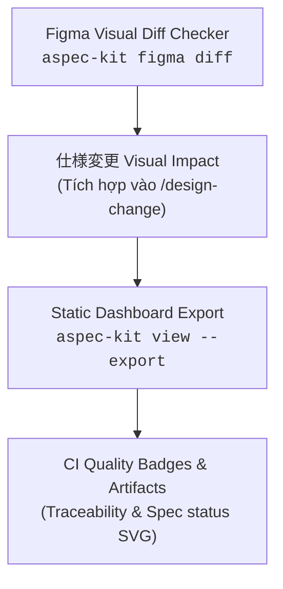
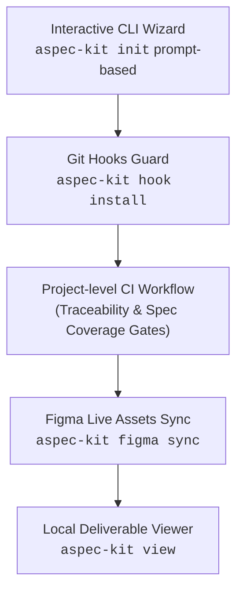

# Roadmap — aspec-kit

Lộ trình phát triển cho `aspec-kit` sau phiên bản `v0.3.1`.

## Trạng thái các phiên bản

- [x] **v0.1.0** — Initial release: template, plugin, CLI scaffolder, 4 agents, `/design-to-code`, 5-tier memory.
- [x] **v0.2.0** — CLI hardening, pinned template tags, strict flags, CI test suite.
- [x] **v0.3.0** & **v0.3.1** — BrSE suite (`/qa-sheet`, `aspec-kit convert`, `/design-change`, `/traceability`, `/test-spec`, `/progress-report`), multi-agent (`--agent`), localization (`--lang`), stack configuration (`--stack`), end-to-end reservation app example.
- [x] **v0.4.0** — Developer Experience, Project CI Quality Gates & External Integrations.

---

## Kế hoạch phát triển phiên bản v0.5.0: Visual Quality & Deliverables Export

Phiên bản `v0.5.0` tập trung hoàn toàn vào chất lượng bàn giao kỹ thuật (deliverables) và hỗ trợ BrSE/Dev xác thực trực quan (Visual Verification), giữ vững triết lý gọn nhẹ (zero-dependency, không lấn sân sang các công cụ quản trị dự án ngoài lề):

### 1. Figma Visual Diff & Regression Checker (`aspec-kit figma diff`)
- So sánh sự thay đổi giữa 2 phiên bản wireframe/screen trong `docs/03-ui/<slug>/screens/`.
- Tự động sinh ảnh hoặc báo cáo visual diff đánh dấu các vị trí thay đổi (added, modified, removed elements).
- Tích hợp trực tiếp vào lệnh `/design-change` để giúp BrSE và khách hàng nhìn thấy ngay điểm khác biệt trên giao diện khi có yêu cầu 仕様変更.

### 2. Static Deliverables Dashboard Export (`aspec-kit view --export`)
- Cho phép xuất toàn bộ Deliverables Dashboard (`aspec-kit view`) thành một file HTML độc lập tĩnh (self-contained static HTML) vào thư mục `docs/deliverables.html` hoặc `build/dashboard/`.
- Phù hợp để đính kèm làm artifact trong GitHub Actions CI hoặc publish trực tiếp lên GitHub Pages / mạng nội bộ cho PM và khách hàng duyệt mà không cần chạy server local.

### 3. CI Quality Badges & Shields Endpoint
- Sinh file huy hiệu SVG chuẩn (`docs/badges/traceability.svg`, `docs/badges/test-specs.svg`) hiển thị tỷ lệ bao phủ AC và Test Spec (ví dụ: `traceability: 100% covered - passing`, `specs: 6/6 AC verified`).
- Gắn trực tiếp vào `README.md` của dự án để phản ánh trạng thái chất lượng theo thời gian thực sau mỗi lần chạy CI.

---

## Milestone v0.4.0: Developer Experience & Quality Gates

### 1. Interactive CLI Wizard (`aspec-kit init`)
- Cho phép người dùng chạy `npx @hoanghainh/aspec-kit init` không cần nhớ cờ lệnh.
- Menu tương tác trực quan chọn ngôn ngữ (`vi`/`en`/`ja`), chọn AI Agent (`claude`, `gemini`, `copilot`, `cursor`), chọn stack (`ts`, `python`, `go`, `java`), steward handle.

### 2. Scaffold Project CI Workflow Template
- Tự động sinh file GitHub Actions workflow cho dự án người dùng khi init (`.github/workflows/ci.yml`).
- Tích hợp chốt chặn nghiêm ngặt:
  - `python3 .claude/scripts/traceability.py check --strict`: Đảm bảo 100% Acceptance Criteria có test case tương ứng.
  - `python3 .claude/scripts/test_spec.py summary`: Kiểm tra 100% AC đã ánh xạ vào テスト仕様書.

### 3. Git Pre-commit Guardrail (`aspec-kit hook install`)
- Cài đặt hook vào `.git/hooks/pre-commit` cho dự án:
  - Chạy formatter theo stack.
  - Ngăn ngừa commit chứa conflict marker hoặc sửa đè vùng dữ liệu gốc của khách (`docs/01-03`, `specs/`).
  - Kiểm tra tính nhất quán của thuật ngữ trong `docs/00-glossary.md`.

### 4. Figma Live Assets Sync (`aspec-kit figma sync`)
- Tích hợp Figma REST API thông qua `FIGMA_PERSONAL_TOKEN`.
- Tự động tải vector SVG hoặc render PNG của wireframes từ Figma về `docs/03-ui/<slug>/screens/`.
- Cập nhật tự động metadata và timestamp trong `docs/03-ui/<slug>/figma-links.md`.

### 5. Local Deliverables Dashboard (`aspec-kit view`)
- Khởi động web server local nhẹ phục vụ BrSE và Project Manager:
  - Ma trận truy vết Traceability trực quan hóa dạng bảng và đồ thị.
  - Bộ lọc câu hỏi Q&A sheet theo trạng thái (*Open / Answered / Resolved*).
  - Timeline báo cáo tiến độ tuần từ `docs/reports/`.
  - Trình xem テスト仕様書 hỗ trợ xuất file Excel/PDF.
