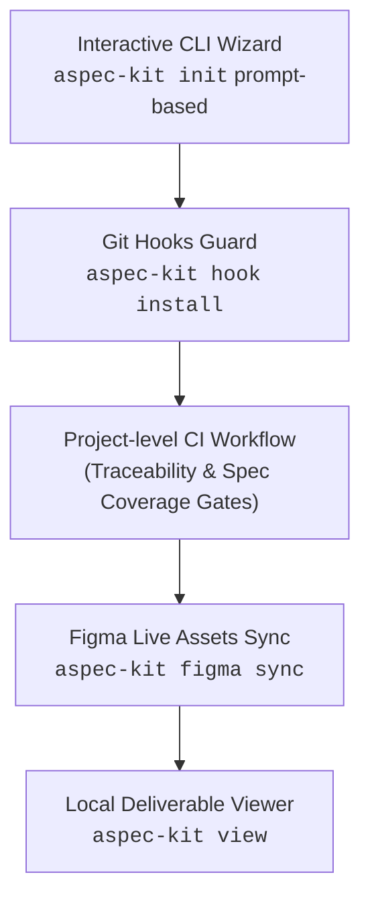

# Roadmap — aspec-kit

Lộ trình phát triển cho `aspec-kit` sau phiên bản `v0.3.1`.

## Trạng thái các phiên bản

- [x] **v0.1.0** — Initial release: template, plugin, CLI scaffolder, 4 agents, `/design-to-code`, 5-tier memory.
- [x] **v0.2.0** — CLI hardening, pinned template tags, strict flags, CI test suite.
- [x] **v0.3.0** & **v0.3.1** — BrSE suite (`/qa-sheet`, `aspec-kit convert`, `/design-change`, `/traceability`, `/test-spec`, `/progress-report`), multi-agent (`--agent`), localization (`--lang`), stack configuration (`--stack`), end-to-end reservation app example.
- [x] **v0.4.0** — Developer Experience, Project CI Quality Gates & External Integrations.

---

## Các ý tưởng & định hướng tiếp theo (v0.5.0+)

### 1. Jira / Confluence Integration (`/jira-sync`)
- Kết nối hai chiều với Atlassian Jira / Confluence:
  - Tự động sinh issue hoặc subtask trên Jira từ `specs/<slug>/tasks.md`.
  - Đồng bộ trạng thái Q&A sheet từ `docs/qa/` lên Jira issue hoặc trang Confluence của khách hàng.

### 2. Figma Visual Diff & Regression Checker
- Tự động so sánh ảnh chụp màn hình wireframe giữa 2 phiên bản snapshot trong `docs/03-ui/<slug>/screens/`.
- Đánh dấu vùng thay đổi (visual diff) để BrSE kiểm tra nhanh khi nhận được thông báo 仕様変更 từ khách hàng.

### 3. CI Quality Badges & Dashboard Export
- Xuất bản bản ghi tĩnh (Static HTML export / Markdown summary) của `aspec-kit view` để deploy lên GitHub Pages hoặc lưu thành artifact báo cáo sau mỗi build CI.
- Huy hiệu (badge) độ phủ Traceability & Test Spec gắn trực tiếp vào README của dự án.

---

## Milestone v0.4.0: Developer Experience & Quality Gates

### 1. Interactive CLI Wizard (`aspec-kit init`)
- Cho phép người dùng chạy `npx @hoanghainh/aspec-kit init` không cần nhớ cờ lệnh.
- Menu tương tác trực quan chọn ngôn ngữ (`vi`/`en`/`ja`), chọn AI Agent (`claude`, `gemini`, `copilot`, `cursor`), chọn stack (`ts`, `python`, `go`, `java`), steward handle.

### 2. Scaffold Project CI Workflow Template
- Tự động sinh file GitHub Actions workflow cho dự án người dùng khi init (`.github/workflows/ci.yml`).
- Tích hợp chốt chặn nghiêm ngặt:
  - `python3 .claude/scripts/traceability.py check --strict`: Đảm bảo 100% Acceptance Criteria có test case tương ứng.
  - `python3 .claude/scripts/test_spec.py summary`: Kiểm tra 100% AC đã ánh xạ vào テスト仕様書.

### 3. Git Pre-commit Guardrail (`aspec-kit hook install`)
- Cài đặt hook vào `.git/hooks/pre-commit` cho dự án:
  - Chạy formatter theo stack.
  - Ngăn ngừa commit chứa conflict marker hoặc sửa đè vùng dữ liệu gốc của khách (`docs/01-03`, `specs/`).
  - Kiểm tra tính nhất quán của thuật ngữ trong `docs/00-glossary.md`.

### 4. Figma Live Assets Sync (`aspec-kit figma sync`)
- Tích hợp Figma REST API thông qua `FIGMA_PERSONAL_TOKEN`.
- Tự động tải vector SVG hoặc render PNG của wireframes từ Figma về `docs/03-ui/<slug>/screens/`.
- Cập nhật tự động metadata và timestamp trong `docs/03-ui/<slug>/figma-links.md`.

### 5. Local Deliverables Dashboard (`aspec-kit view`)
- Khởi động web server local nhẹ phục vụ BrSE và Project Manager:
  - Ma trận truy vết Traceability trực quan hóa dạng bảng và đồ thị.
  - Bộ lọc câu hỏi Q&A sheet theo trạng thái (*Open / Answered / Resolved*).
  - Timeline báo cáo tiến độ tuần từ `docs/reports/`.
  - Trình xem テスト仕様書 hỗ trợ xuất file Excel/PDF.
