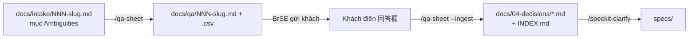

# 質問票 (Q&A sheet) — bảng câu hỏi gửi khách

Output của `/qa-sheet`. Mỗi feature 1 cặp file, **`<NNN>-<slug>` khớp tên branch và file intake**:

| File | Vai trò |
|---|---|
| `docs/qa/<NNN>-<slug>.md` | **Nguồn sự thật** của sheet — LLM soạn bằng 敬語, review qua PR diff |
| `docs/qa/<NNN>-<slug>.csv` | Bản Excel gửi khách — **sinh tự động**, UTF-8 BOM + CRLF, không sửa tay |

Ví dụ hoàn chỉnh (feature mẫu, xoá khi bắt đầu dự án — nên không đặt link):
`docs/qa/000-example-reservation.md` và `.csv`, sinh từ `docs/intake/000-example-reservation.md`.

## Vòng đời



1. `/qa-sheet <NNN>-<slug>` — đọc intake, mỗi ambiguity → **đúng 1 câu**, ID `Q-<NNN>-<ii>`
   (ambiguity thứ *i* ↔ câu thứ *i*). Thuật ngữ lấy từ `docs/00-glossary.md`, `glossary-steward` kiểm.
2. Review rồi gửi khách file `.csv` (hoặc dán bảng `.md`). Agent **không** tự gửi.
3. Khách trả về → lưu đè vào `docs/qa/<NNN>-<slug>.csv` (giữ tên file) → `/qa-sheet --ingest docs/qa/<NNN>-<slug>.csv`.
   Câu đã có file quyết định chứa ID đó sẽ bị bỏ qua → chạy ingest nhiều lần an toàn.

## Quy tắc ID & bảng

- Cột cố định: `No | 対象画面/機能 | 質問内容 | 背景・提案 | 回答欄 | 回答期限 | ステータス`.
- `ステータス`: `未回答` → `確認中` → `回答済`; câu không còn cần hỏi → `取下げ` (**không xoá dòng**).
- ID **không bao giờ đánh lại số**. Intake thêm ambiguity → thêm dòng cuối với ID kế tiếp.
- Ambiguity đã chốt trong `docs/04-decisions/INDEX.md` → giữ dòng nhưng `取下げ` (không hỏi lại).
- Trong ô `.md`: xuống dòng bằng `<br>`, ký tự `|` viết `\|`.

## Script tất định

Mọi phần không được để LLM tự do đều qua `.claude/scripts/qa_sheet.py` (stdlib, không cần mạng):

```bash
python3 .claude/scripts/qa_sheet.py due --days 5                     # hạn trả lời: +5 ngày làm việc (chưa trừ 祝日)
python3 .claude/scripts/qa_sheet.py export docs/qa/042-user-reservation.md   # validate + ghi .csv (BOM)
python3 .claude/scripts/qa_sheet.py ingest docs/qa/042-user-reservation.csv  # JSON câu đã trả lời, chưa ghi
```

- `export` fail nếu: sai header, ID sai định dạng/không liên tục/không khớp số feature, ステータス lạ,
  **số câu < số ambiguity** của intake, hoặc câu thừa mà không phải `取下げ`.
- `ingest` đọc được `.md`, CSV UTF-8 (có/không BOM) và CSV Shift_JIS (Excel "CSV" mặc định trên
  Windows Nhật). Có 回答欄 nhưng ステータス chưa `回答済` → cảnh báo, command dừng hỏi lại.
- Test: `python3 -m unittest discover -s .claude/scripts`.

## Ghi quyết định

Mỗi câu trả lời → 1 file `docs/04-decisions/<YYYY-MM-DD>-<slug>.md` theo template
[`docs/04-decisions/README.md`](../04-decisions/README.md), **thêm dòng** `- Mã câu hỏi (質問票): \`Q-<NNN>-<ii>\``
(đây là khoá chống ghi trùng) + 1 dòng trong [`INDEX.md`](../04-decisions/INDEX.md).
