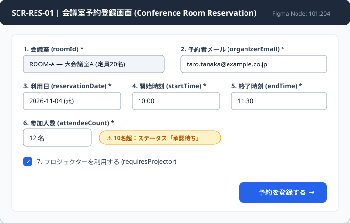

# `01-reservation-app` — 会議室予約システム (`SCR-RES-01`)

Dự án mẫu End-to-End minh hoạ toàn bộ vòng đời phát triển theo chuẩn `aspec-kit` cho phân hệ **Đặt phòng họp nội bộ (`001-conference-room-reservation`)**.



---

## Cấu trúc thư mục

```text
examples/01-reservation-app/
├── docs/
│   ├── 00-glossary.md                                              # Bảng thuật ngữ JP-VI-EN
│   ├── 01-basic-design/conference-room-reservation/
│   │   ├── reservation-basic-design.pdf                            # 基本設計書 (PDF gốc)
│   │   ├── reservation-basic-design.md                             # Markdown sinh từ convert-design.py
│   │   └── CHANGELOG.md
│   ├── 02-detail-design/conference-room-reservation/
│   │   ├── reservation-detail-design.xlsx                          # 詳細設計書 (Excel 4 sheets gốc)
│   │   ├── reservation-detail-design.md                            # Index Markdown
│   │   ├── reservation-detail-design__01_画面一覧.md
│   │   ├── reservation-detail-design__02_画面項目定義.md
│   │   ├── reservation-detail-design__03_バリデーション・エラー.md
│   │   ├── reservation-detail-design__04_改訂履歴.md
│   │   └── CHANGELOG.md
│   ├── 03-ui/conference-room-reservation/
│   │   ├── figma-links.md                                          # Mapping UI component ↔ 詳細設計
│   │   └── screen-scr-res-01.svg                                   # Snapshot màn hình SCR-RES-01
│   ├── intake/001-conference-room-reservation.md                   # Bản phân tích từ design-intake
│   ├── qa/
│   │   ├── 001-conference-room-reservation.md                      # 質問票 (Markdown)
│   │   └── 001-conference-room-reservation.csv                     # 質問票 (Excel CSV UTF-8 BOM)
│   ├── 04-decisions/
│   │   ├── INDEX.md
│   │   └── 2026-10-25-Q-001-01-approval-threshold.md               # Quyết định khách hàng cho Q-001-01/02
│   ├── test-specs/
│   │   ├── 001-conference-room-reservation.md                      # テスト仕様書 (Markdown)
│   │   └── 001-conference-room-reservation.csv                     # テスト仕様書 (Excel CSV UTF-8 BOM)
│   ├── reports/2026-10-31-conference-room-reservation.md           # 週次進捗報告 (Weekly Progress Report)
│   └── traceability.md                                             # 要件トレーサビリティマトリクス
├── specs/001-conference-room-reservation/
│   ├── spec.md                                                     # 6 Acceptance Criteria (AC 1..6)
│   ├── plan.md                                                     # Kế hoạch kiến trúc
│   └── tasks.md                                                    # 5 tasks (T1..T5) đã hoàn thành
└── src/features/conference-room-reservation/
    ├── types.ts
    ├── validateReservation.ts
    ├── createReservation.ts
    └── createReservation.test.ts                                   # Unit tests phủ AC 1..6
```

---

## Chạy thử & Kiểm chứng từ thư mục gốc repository

```bash
# 1. Chạy bộ unit test (AC 1..6) với Vitest
npx --yes vitest@3 run examples/01-reservation-app/src/features/conference-room-reservation

# 2. Kiểm tra độ phủ Traceability Matrix ở chế độ nghiêm ngặt (--strict)
python3 .claude/scripts/traceability.py check --root examples/01-reservation-app --strict

# 3. Validate & xuất CSV cho 質問票 (QA Sheet) và テスト仕様書 (Test Spec)
python3 .claude/scripts/qa_sheet.py export examples/01-reservation-app/docs/qa/001-conference-room-reservation.md
python3 .claude/scripts/test_spec.py export examples/01-reservation-app/docs/test-specs/001-conference-room-reservation.md \
  --spec examples/01-reservation-app/specs/001-conference-room-reservation/spec.md

# 4. Validate cấu trúc 4 phần của 進捗報告 (Progress Report)
python3 .claude/scripts/progress_report.py validate examples/01-reservation-app/docs/reports/2026-10-31-conference-room-reservation.md
```
