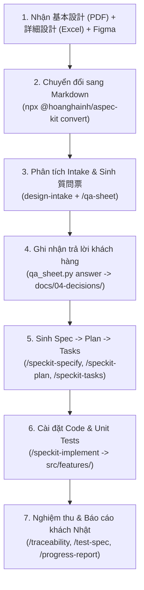

# End-to-End Examples (`examples/`)

Thư mục này chứa các dự án mẫu hoàn chỉnh từ đầu đến cuối (**Intake → Q&A → Spec/Plan/Tasks → Code & Tests → Traceability / テスト仕様書 / 進捗報告**) để bạn trải nghiệm trực quan luồng làm việc của `aspec-kit` trong dự án khách hàng Nhật Bản.

> **Lưu ý**: Thư mục `examples/` nằm trong [`.aspecignore`](../.aspecignore) và `DEFAULT_EXCLUDES` nên **không bị sao chép** vào dự án mới khi chạy `npx @hoanghainh/aspec-kit init`.

---

## Danh mục dự án mẫu

| Dự án | Bài toán | Đầu vào thiết kế (JP) | Đầu ra nghiệm thu |
|---|---|---|---|
| [`01-reservation-app`](./01-reservation-app/README.md) | Hệ thống đặt phòng họp nội bộ (`SCR-RES-01` — 会議室予約登録画面) | 基本設計 PDF + 詳細設計 Excel (`.xlsx` 4 sheets) + Figma SVG snapshot | Full TypeScript + Vitest (`AC 1`..`AC 6`), 質問票 CSV, テスト仕様書 CSV, Traceability Matrix, 進捗報告 |

---

## Walkthrough End-to-End: Từ tài liệu khách Nhật đến Pull Request

Dưới đây là hành trình 7 bước mà một **BrSE / Developer** thực hiện trên [`01-reservation-app`](./01-reservation-app/README.md):



### Bước 1 — Nhận tài liệu thiết kế gốc từ khách hàng Nhật

Khách hàng bàn giao 3 nguồn tài liệu:
1. **基本設計書 (Basic Design PDF)**: [`reservation-basic-design.pdf`](./01-reservation-app/docs/01-basic-design/conference-room-reservation/reservation-basic-design.pdf)
2. **詳細設計書 (Detail Design Excel — 4 sheets)**: [`reservation-detail-design.xlsx`](./01-reservation-app/docs/02-detail-design/conference-room-reservation/reservation-detail-design.xlsx)
   - `画面一覧`, `画面項目定義`, `バリデーション・エラー`, `改訂履歴`
3. **UI / Figma Wireframe**: [`figma-links.md`](./01-reservation-app/docs/03-ui/conference-room-reservation/figma-links.md) & [`screen-scr-res-01.svg`](./01-reservation-app/docs/03-ui/conference-room-reservation/screen-scr-res-01.svg)

### Bước 2 — Chuyển đổi Excel / PDF sang Markdown giữ nguyên cấu trúc bảng

```bash
npx @hoanghainh/aspec-kit convert examples/01-reservation-app/docs/02-detail-design/conference-room-reservation/reservation-detail-design.xlsx
npx @hoanghainh/aspec-kit convert examples/01-reservation-app/docs/01-basic-design/conference-room-reservation/reservation-basic-design.pdf \
  --out examples/01-reservation-app/docs/01-basic-design/conference-room-reservation
```

Kết quả sinh ra các file Markdown tách theo từng sheet ([`reservation-detail-design.md`](./01-reservation-app/docs/02-detail-design/conference-room-reservation/reservation-detail-design.md)) kèm `CHANGELOG.md` chứa mã băm SHA-256 của file gốc.

### Bước 3 — Chạy `design-intake` và xuất 質問票 (`/qa-sheet`)

- Subagent `design-intake` đọc các bản Markdown chuyển đổi, chuẩn hoá thuật ngữ vào [`docs/00-glossary.md`](./01-reservation-app/docs/00-glossary.md) và tạo [`docs/intake/001-conference-room-reservation.md`](./01-reservation-app/docs/intake/001-conference-room-reservation.md).
- Khi phát hiện điểm mơ hồ (ví dụ: ngưỡng phê duyệt `10名以上` vs `10名超`), lệnh `/qa-sheet` tạo bảng hỏi đáp tiếng Nhật lịch sự (敬語) tại [`docs/qa/001-conference-room-reservation.md`](./01-reservation-app/docs/qa/001-conference-room-reservation.md) và xuất file [`001-conference-room-reservation.csv`](./01-reservation-app/docs/qa/001-conference-room-reservation.csv) (UTF-8 BOM) để gửi khách hàng mở trực tiếp bằng Excel.

### Bước 4 — Ghi nhận quyết định của khách hàng (`docs/04-decisions/`)

Sau khi khách hàng (鈴木様) phản hồi trên 質問票, quyết định được lưu vết vĩnh viễn tại [`docs/04-decisions/2026-10-25-Q-001-01-approval-threshold.md`](./01-reservation-app/docs/04-decisions/2026-10-25-Q-001-01-approval-threshold.md) và cập nhật vào [`docs/04-decisions/INDEX.md`](./01-reservation-app/docs/04-decisions/INDEX.md).

### Bước 5 — Sinh Spec, Plan và Tasks (`specs/001-conference-room-reservation/`)

Từ Intake và Decision Log đã chốt:
- [`spec.md`](./01-reservation-app/specs/001-conference-room-reservation/spec.md): Định nghĩa 6 tiêu chí nghiệm thu đánh số `AC 1`..`AC 6`.
- [`plan.md`](./01-reservation-app/specs/001-conference-room-reservation/plan.md): Thiết kế kiến trúc module thuần TypeScript.
- [`tasks.md`](./01-reservation-app/specs/001-conference-room-reservation/tasks.md): Chia nhỏ thành `T1`..`T5`, mỗi task gắn rõ file nguồn và mã `(AC N)`.

### Bước 6 — Cài đặt Code & Unit Tests (`src/features/conference-room-reservation/`)

- [`types.ts`](./01-reservation-app/src/features/conference-room-reservation/types.ts), [`validateReservation.ts`](./01-reservation-app/src/features/conference-room-reservation/validateReservation.ts), [`createReservation.ts`](./01-reservation-app/src/features/conference-room-reservation/createReservation.ts)
- [`createReservation.test.ts`](./01-reservation-app/src/features/conference-room-reservation/createReservation.test.ts): Kiểm thử tự động toàn bộ `AC 1`..`AC 6`.

### Bước 7 — Sinh bộ hồ sơ nghiệm thu & báo cáo tiến độ cho khách Nhật

1. **Ma trận truy vết (`/traceability`)**: [`docs/traceability.md`](./01-reservation-app/docs/traceability.md) — chứng minh 100% `AC 1`..`AC 6` đều có task `[x]`, code và test case tương ứng.
2. **Tài liệu kịch bản kiểm thử (`/test-spec` — テスト仕様書)**: [`docs/test-specs/001-conference-room-reservation.md`](./01-reservation-app/docs/test-specs/001-conference-room-reservation.md) + [`.csv`](./01-reservation-app/docs/test-specs/001-conference-room-reservation.csv).
3. **Báo cáo tiến độ tuần (`/progress-report` — 進捗報告)**: [`docs/reports/2026-10-31-conference-room-reservation.md`](./01-reservation-app/docs/reports/2026-10-31-conference-room-reservation.md).
